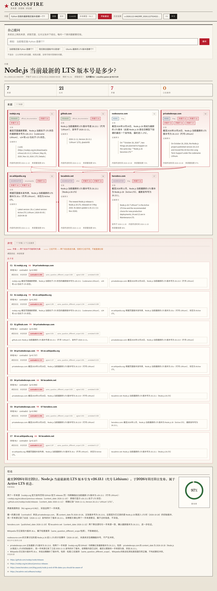
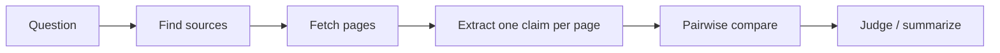

# Crossfire

[](https://github.com/FishySean/Crossfire/actions/workflows/test.yml)
[中文](README.zh.md)

Crossfire is a fact-checking engine: it pulls several sources for a question, extracts one claim per page, compares every pair, and surfaces disagreements instead of smoothing them into one answer.



## What problem it solves

AI search often merges sources into a single paragraph. When two pages disagree, that disagreement gets averaged away.

Crossfire treats disagreement as the output. Pairwise comparisons label each relationship as:

- **wrong** (`contradict`) — mutually exclusive claims
- **outdated** — same question, different time
- **different framing** (`same_question_different_scope`) — both can be true under different definitions
- **agree** / **unrelated**

Honesty check: some AI search tools already mention that sources disagree. Crossfire’s difference is that it does this systematically — every usable pair is scored, and the result is structured (claims, pairs, judgment, provenance), not a prose aside.

## How it works



1. **Find sources** — Claude web search proposes candidate URLs (must appear in real search results).
2. **Fetch** — HTTP (default) or Steel cloud browser; unusable pages are dropped loudly.
3. **Extract** — one claim per page, with evidence quotes and dates.
4. **Compare** — every pair of claims (Claude API or a local NLI model).
5. **Judge** — synthesize a confidence-tagged answer from claims + pairs.

## Quick start

Needs Python 3.12+ and [uv](https://docs.astral.sh/uv/).

```bash
git clone https://github.com/FishySean/Crossfire.git
cd Crossfire
uv sync
cp .env.example .env
```

Edit `.env`:

| Key | Required when | Where to get it |
|---|---|---|
| `ANTHROPIC_API_KEY` | always for live ask / extract / judge | [console.anthropic.com](https://console.anthropic.com/) |
| `STEEL_API_KEY` | only if `FETCHER=steel` | [steel.dev](https://steel.dev/) |

Defaults: `FETCHER=http` (no Steel key), `PAIRER=claude`. For free local pairing:

```bash
uv sync --group nli
# in .env:
# PAIRER=nli
# NLI_MODEL=FishySean/crossfire-pairer
# NLI_MODEL_REVISION is already locked in config; leave it unless you publish a new model
```

Run tests (offline, no API keys):

```bash
uv run pytest
```

Start the UI (checks `.env`, picks a free port from 8765, opens the browser):

```bash
uv run python app.py
```

Or ask from the CLI (prints a cost estimate and waits for confirmation unless `--yes`):

```bash
uv run crossfire ask "What is the current stable Python version?" --pairer nli
```

## Configuration

| Setting | Values | Meaning | Cost |
|---|---|---|---|
| `PAIRER` | `claude` (default) / `nli` | Who compares claim pairs | Claude: API $ per pair. NLI: free on your machine (~550MB download once) |
| `FETCHER` | `http` (default) / `steel` | How live pages are downloaded | HTTP: free; fails on hard anti-bot / JS shells. Steel: paid cloud browser |
| mode | `live` / `cached` | Live hits the network; cached reads `out/cache/` | Cached needs no fetcher key; still needs Anthropic for extract/judge unless you only browse history |

Only `crossfire/config.py` reads `.env` / environment variables. Same-named env vars win over the file. See `.env.example` for the full list.

## Cost (per ask)

Estimates use Sonnet pricing and a floor of 4 usable sources (`FETCHER=http`). More sources → higher.

| Pairer | ~4 sources | ~6 sources | ~8 sources |
|---|---|---|---|
| NLI (pairing free) | ~$0.18 | ~$0.21 | ~$0.24 |
| Claude pairing | ~$0.22 | ~$0.31 | ~$0.43 |

Breakdown: web search + find/extract/judge tokens; Steel adds ~$0.005/page if you switch `FETCHER=steel`. `MAX_COST_PER_QUESTION` (default `$1`) rejects runs over the estimate before they start.

## Self-trained pairer

Hugging Face: [FishySean/crossfire-pairer](https://huggingface.co/FishySean/crossfire-pairer)

- Fine-tuned mDeBERTa on Claude-labeled claim pairs from this repo’s question bank.
- Locked revision: `0517c59dfa13038226b4b66c3fa6b605b9215df5` (also the default in `crossfire/config.py`).
- Test macro-F1 ≈ **0.614** (seed 44); mean over three seeds ≈ **0.576**.
- Known issues: `same_question_different_scope` recall is low; contradict barely beats the untuned base; confidence scores are **not calibrated** (high `p` ≠ correct).

Training docs: [`training/README.md`](training/README.md) (Colab T4 notebook is the main path).

## Evaluation

Frozen cases live under `evals/cases/` with page snapshots in `evals/snapshots/`. Scoring is deterministic regex/number rules — no model-as-judge.

```bash
uv run crossfire eval --estimate-only   # request count only
uv run crossfire eval                   # all cases
uv run crossfire eval --case python-2026-11
```

Needs `ANTHROPIC_API_KEY`. Never fetches live; only reads snapshots.

## Things we learned while building

From [`notes/demo-findings.md`](notes/demo-findings.md):

1. **Most authoritative ≠ most discriminative.** nodejs.org marks both v22 and v24 as “LTS” without Active vs Maintenance — correct, and useless for “which is Active LTS?”. The release schedule table on GitHub actually answers the question.
2. **The more complete a source, the less it can be tested.** A Wikipedia page that states both metro and prefecture population figures hedges itself into zero contradictions; a single-scope source produces several.
3. **Without today’s date, the model uses stale knowledge to veto primary sources.** On a live Python run, the judge dismissed python.org’s 3.15.2 as “beyond the known release sequence” until we passed an explicit `as_of` date into extract/judge prompts.

## Known limitations

- **HTTP fetcher** cannot pass strict anti-bot or JS-only shells; those pages fail loudly — switch sources or use `FETCHER=steel`.
- **Well-known contested topics** often yield *no* contradictions: extract collapses both sides into one hedged claim.
- **NLI model**: small data; weak scope class; uncalibrated probabilities; contradict F1 ≈ untuned base.
- **Data volume** is tiny (hundreds of labeled pairs after augmentation). Treat scores as a starting point, not a ceiling.

## Development

```bash
uv sync                         # core + pytest (no torch)
uv run pytest                   # must pass with 0 skipped offline
uv sync --group nli             # local pairer
uv sync --group train           # training extras
uv sync --group e2e && uv run playwright install chromium
uv run pytest tests/training
uv run pytest tests/e2e
```

CI (`.github/workflows/test.yml`): four jobs — `core`, `nli`, `train`, `e2e`. Green CI is the source of truth.

**Before every push**, check in a clean env (a local `.venv` that already has torch can hide missing-optional-dep bugs):

```bash
rm -rf .venv-clean
UV_PROJECT_ENVIRONMENT=.venv-clean uv sync
UV_PROJECT_ENVIRONMENT=.venv-clean uv run pytest
```

Architecture notes: [`docs/architecture.md`](docs/architecture.md).

## License

MIT — © Shaoheng Fan. See [`LICENSE`](LICENSE).
