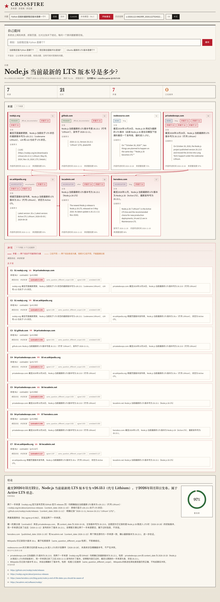
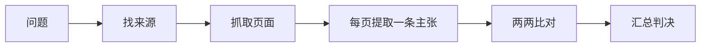

# Crossfire

[](https://github.com/FishySean/Crossfire/actions/workflows/test.yml)
[English](README.md)

Crossfire 是一个查证引擎：针对一个问题拉取多个来源，每页提取一条主张，两两比对，把分歧本身当作输出，而不是揉成一段「综合答案」。



## 它解决什么问题

AI 搜索常把多个来源揉成一段话。两页说法不一致时，分歧往往被平均掉了。

Crossfire 把分歧当作输出。两两比对会给每对关系打上标签：

- **写错了**（`contradict`）——互相排斥的主张
- **过时了**——同一问题、不同时间点
- **口径不同**（`same_question_different_scope`）——定义不同时两边都可以为真
- **一致** / **无关**

说实话：现在有的 AI 搜索也会提到「来源不一致」。Crossfire 的区别在于系统地做——每一个可用对都会打分，结果是结构化的（主张、配对、判决、provenance），不是段落里随口一句。

## 工作原理



1. **找来源** —— Claude web search 提出候选网址（必须出现在真实搜索结果里）。
2. **抓取** —— HTTP（默认）或 Steel 云端浏览器；不可用页面会大声失败。
3. **提取** —— 每页一条主张，带原文依据和日期。
4. **比对** —— 主张两两配对（Claude API 或本地 NLI 模型）。
5. **判决** —— 根据主张与配对给出带置信度的结论。

## 快速开始

需要 Python 3.12+ 和 [uv](https://docs.astral.sh/uv/)。

```bash
git clone https://github.com/FishySean/Crossfire.git
cd Crossfire
uv sync
cp .env.example .env
```

编辑 `.env`：

| 键 | 何时需要 | 去哪申请 |
|---|---|---|
| `ANTHROPIC_API_KEY` | live 提问 / 提取 / 判决都要 | [console.anthropic.com](https://console.anthropic.com/) |
| `STEEL_API_KEY` | 仅当 `FETCHER=steel` | [steel.dev](https://steel.dev/) |

默认：`FETCHER=http`（不用 Steel）、`PAIRER=claude`。本地免费比对：

```bash
uv sync --group nli
# 在 .env 里：
# PAIRER=nli
# NLI_MODEL=FishySean/crossfire-pairer
# NLI_MODEL_REVISION 已在 config 里锁死；除非你发布了新模型，否则不用改
```

`uv sync --group X` 会把环境收成「默认依赖 + 该组」。要同时保留多组可选依赖：`uv sync --group nli --group e2e`。

跑测试（离线、不需要 API key）：

```bash
uv run pytest
```

启动界面（检查 `.env`、从 8765 起选空闲端口、自动开浏览器）。
`FETCHER=http` 时，没有 `out/cache/`、没有 `STEEL_API_KEY` 都没问题——Ask / live 不依赖它们。

```bash
uv run python app.py
# 或者：uv run python app.py --no-browser
```

或用命令行提问（会先打印预计费用，除非加 `--yes`）：

```bash
uv run crossfire ask "当前稳定版 Python 是哪个？" --pairer nli
```

## 配置选项

| 配置 | 取值 | 含义 | 费用 |
|---|---|---|---|
| `PAIRER` | `claude`（默认）/ `nli` | 谁来比对主张对 | Claude：按次 API 费。NLI：本机免费（首次约下 550MB） |
| `FETCHER` | `http`（默认）/ `steel` | live 怎么下页面 | HTTP：免费；严反爬 / 纯 JS 壳会挂。Steel：付费云浏览器 |
| mode | `live` / `cached` | live 上网；cached 读 `out/cache/` | cached 不要抓取 key；提取/判决仍要 Anthropic（只看历史结果除外） |

只有 `crossfire/config.py` 读 `.env` / 环境变量。同名环境变量优先于文件。完整列表见 `.env.example`。

## 费用（每问一题）

按 Sonnet 单价和真实 ask 校准过的 per-call token 上限估算（详见 `ask_question.py` 注释）。`FETCHER=http`。

| 比对器 | ~4 来源 | ~6 来源 | ~8 来源 |
|---|---|---|---|
| NLI（比对免费） | ~$0.39 | ~$0.51 | ~$0.63 |
| Claude 比对 | ~$0.49 | ~$0.75 | ~$1.07 |

确认框和 CLI 显示**区间**：约 `$低`（4 个来源）～ `$高`（8 个来源）。运行前的上限检查用 **4 来源下限**；来源数确定后会按真实数量再估一次，若超 `MAX_COST_PER_QUESTION`（默认 `$1`）则在提取前停下。第一次 `PAIRER=nli` 会从 Hugging Face 下载约 550MB 权重到 HF 缓存。

构成：web search + 找来源/提取/判决的 token；若改 `FETCHER=steel`，大约再加 $0.005/页。

## 自训练模型

Hugging Face：[FishySean/crossfire-pairer](https://huggingface.co/FishySean/crossfire-pairer)

- 在本仓库题库上，用 Claude 打的比对标签微调 mDeBERTa。
- 锁定 revision：`0517c59dfa13038226b4b66c3fa6b605b9215df5`（也是 `crossfire/config.py` 的默认值）。
- 测试宏平均 F1 ≈ **0.614**（seed 44）；三种子均值 ≈ **0.576**。
- 已知问题：`same_question_different_scope` 召回偏低；contradict 几乎没超过未微调基座；置信度**未校准**（`p` 高 ≠ 答对）。

训练说明：[`training/README.md`](training/README.md)（主线是 Colab T4 笔记本）。

## 评测

题目在 `evals/cases/`，页面快照在 `evals/snapshots/`。判分是确定性的正则/数字规则，不用模型打分。

```bash
uv run crossfire eval --estimate-only   # 只打印预计请求数
uv run crossfire eval                   # 全部用例
uv run crossfire eval --case python-2026-11
```

需要 `ANTHROPIC_API_KEY`。从不实时抓取，只读快照。

## 开发中的发现

摘自 [`notes/demo-findings.md`](notes/demo-findings.md)：

1. **最权威的来源 ≠ 最有判别力的来源。** nodejs.org 把 v22 和 v24 都标成 LTS，不区分 Active / Maintenance——说法没错，却答不了「哪个是 Active LTS」。真正说清楚的是 GitHub 上的发布日程表。
2. **越全面的来源越无法被检验。** 维基同时写都市圈和都口径人口，等于自我对冲，贡献零矛盾；只报一个口径的来源反而打出多对矛盾。
3. **模型不知道今天的日期时，会用旧知识否定一手来源。** 一次 live 的 Python 题里，判决把官网的 3.15.2 当成「超出已知发布序列」否掉；后来在提取/判决里显式传入 `as_of` 才稳住。

## 已知限制

- **HTTP 抓取器**进不了反爬很严或纯 JS 壳的网站；这些页会大声失败——换来源，或改用 `FETCHER=steel`。
- **公认有争议的话题**反而经常找不到矛盾：提取会把两边压进一条对冲主张。
- **NLI 模型**：数据少；口径类弱；概率未校准；contradict F1 ≈ 未微调基座。
- **数据量小**（增强后也就几百条标签对）。分数是起点，不是天花板。

## 开发

```bash
uv sync                         # 主程序 + pytest（不含 torch）
uv run pytest                   # 离线必须全绿、0 skipped
uv sync --group nli             # 本地比对器（会重写环境——见快速开始里的说明）
uv sync --group train           # 训练额外依赖
uv sync --group e2e && uv run playwright install chromium
# 同时保留多组：uv sync --group nli --group e2e
uv run pytest tests/training
uv run pytest tests/e2e
```

CI（`.github/workflows/test.yml`）四个任务：`core` / `nli` / `train` / `e2e`。以 CI 全绿为准。

**每次推送前**，在干净环境里再跑一遍（本机已装过 torch 的 `.venv` 会掩盖「缺可选依赖」类问题）：

```bash
rm -rf .venv-clean
UV_PROJECT_ENVIRONMENT=.venv-clean uv sync
UV_PROJECT_ENVIRONMENT=.venv-clean uv run pytest
```

架构说明：[`docs/architecture.md`](docs/architecture.md)。

## 许可证

MIT — © Shaoheng Fan。见 [`LICENSE`](LICENSE)。
