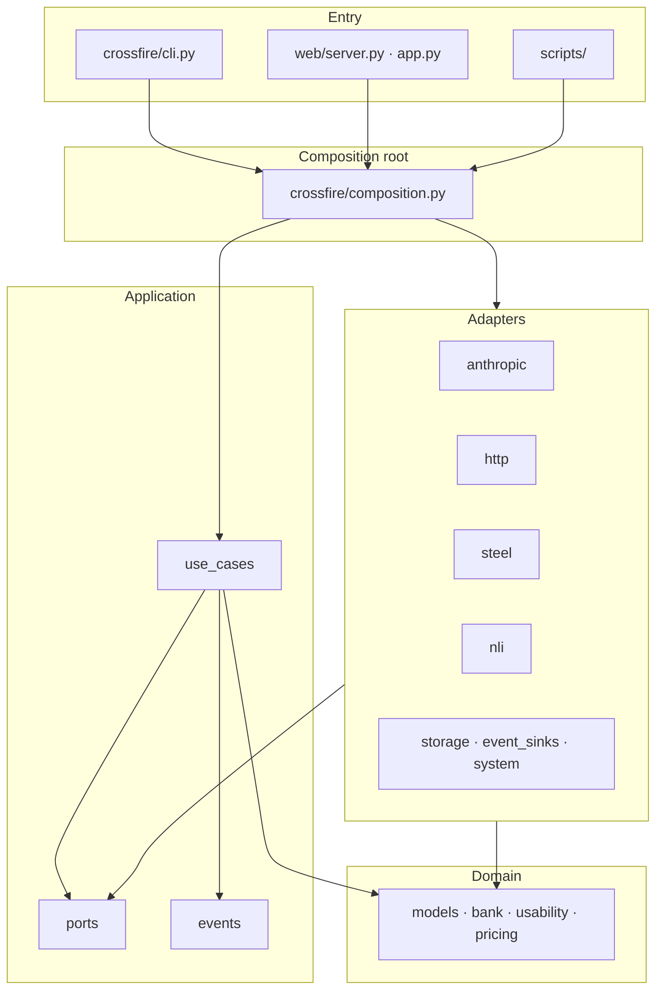

# Architecture

Crossfire is a hexagonal (ports & adapters) app. Business rules live in the center; I/O lives outside.

## Layers

Dependency rule: arrows point **inward**. `domain` knows nothing about adapters. `application` depends only on `domain` + itself. Only `composition.py` (inside `crossfire/`) may import adapters. Entry points may import `composition`, `config`, `domain`, and public application types (`use_cases`, `events`, `records`) — not adapters directly.

Only `crossfire/config.py` may read `.env` / `os.environ`.

## What enforces this

`tests/test_architecture.py` parses import graphs with `ast` and fails CI if:

- `domain` / `application` import outward
- use cases import filesystem, threads, JSON, or system clock helpers
- entry points import adapters
- any file other than `config.py` loads dotenv / env vars

Feature tests under `tests/` lock event field sets and “failures must be loud” behavior.

## Ports and implementations

| Port | Role | Implementations |
|---|---|---|
| `PageFetcher` | Fetch pages in URL order; per-page failure → `ok=False` | `HttpPageFetcher`, `SteelPageFetcher`, `CachedPageFetcher` |
| `ClaimExtractor` | One claim per page | `ClaudeClaimExtractor` |
| `ClaimPairer` | Batch pairwise relations | `ClaudeClaimPairer`, `NliClaimPairer` |
| `VerdictJudge` | Final answer from claims + pairs | `ClaudeVerdictJudge` (+ `HeartbeatJudge` decorator) |
| `SourceFinder` | Real web search → candidate URLs | `ClaudeSourceFinder` |
| `QuestionProposer` | Propose bank questions by category | `ClaudeQuestionProposer` |
| `RunRepository` | Atomic run persistence | `JsonRunRepository` |
| `PageStore` | Cache pages with `fetched_at` | `CachePageStore` |
| `EventSink` | Progress events (may be threaded) | `QueueEventSink`, `NullEventSink` |
| `Clock` / `Ticker` | Wall time + heartbeat scheduling | `SystemClock`, `ThreadTicker` |

`PAIRER` and `FETCHER` in `Settings` select implementations in `composition.build_pairer` / `build_live_fetcher`. Use cases never branch on those enums.

## Adding a new pairer (worked example)

Goal: add a third `ClaimPairer` without touching use cases or the UI beyond wiring.

1. **Implement the port** — new module under `crossfire/adapters/…` with a class that satisfies `ClaimPairer` (`pair_all`, `provenance`). Prefer returning failed `Pair`s over raising once extraction has already spent money.
2. **Register the choice** — add a value to `Pairer` in `crossfire/config.py`; parse it from env in `Settings`.
3. **Wire it** — one new `case` in `composition.build_pairer`. Optionally extend `pairer_availability()` so the UI can show enable/disable reasons.
4. **Tests** — unit-test the adapter with fakes; architecture tests already forbid importing it from use cases.

**Do not change:** `VerifyQuestion`, `AskQuestion`, `ports.py` (unless the port contract itself must grow), event types (unless you only *add* optional fields), or the frontend’s existing event handlers.

Symmetric pattern for a new live fetcher: `Fetcher` enum + `build_live_fetcher` branch + adapter class.

## Event protocol

SSE payloads are `Event.to_dict()`. Field names, set, and order are the contract (`tests/test_events.py`).

| Type | Fields |
|---|---|
| `start` | `question`, `total_sources` |
| `fetch_done` | `url`, `ok`, `chars`, `index`, `unusable_reason?` |
| `claim_done` | `url`, `claim`, `tier`, `index`, `failed?` |
| `pair_start` | `total_pairs` |
| `pair_done` | `a_url`, `b_url`, `relation`, `nature`, `index`, `total`, `scores?` |
| `judge_start` | _(none beyond type)_ |
| `heartbeat` | `step`, `elapsed` |
| `done` | `judgment`, `run_file`, `elapsed` |
| `error` | `step`, `detail` |
| `source_search_start` | `question`, `question_id` |
| `source_candidate` | `url`, `title`, `tier` |
| `source_filtered` | `url`, `reason`, `detail` |
| `sources_ready` | `count`, `has_primary`, `urls` |
| `sources_insufficient` | `kept`, `found`, `filtered`, `detail` |
| `ask_cost_rejected` | `total_usd`, `max_cost_usd` |

**Rule: append-only.** You may add optional fields with defaults (as `failed`, `scores`, `unusable_reason` did). Do not rename, remove, or change the meaning of existing fields — old clients and stored scripts depend on them.

## Design decisions

**Batch `pair_all` / `extract_all`.** Remote APIs want concurrency; GPU NLI wants large batches. A one-pair-at-a-time port would serialize the GPU. The port hands the whole batch to the adapter; scheduling stays an implementation detail.

**Heartbeat as a decorator.** `judge` is one blocking call (tens of seconds) with no natural progress. `HeartbeatJudge` wraps any `VerdictJudge`, emitting `heartbeat` on a timer without teaching the Claude adapter about SSE. Heartbeats report elapsed time only — never fake percent-done.

**Failures must be loud.** Early bugs swallowed errors as empty lists or soft UI skips (parse failures, fetch failures not in `failures`, bad `conflicts` shapes, empty source-finder on billing errors). The rule now: prefer failed entities + `error` events + non-empty `RunResult.failures` over silent zeros. Empty results must mean “genuinely empty,” not “something broke.”
